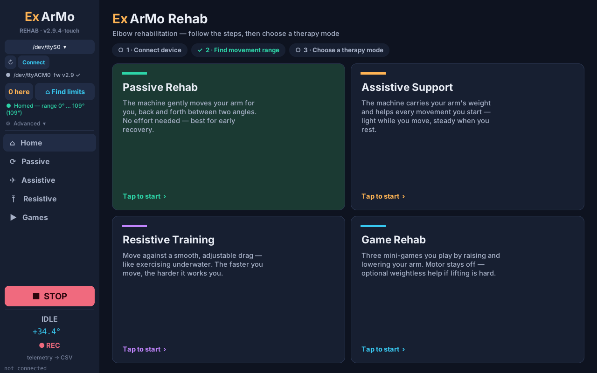
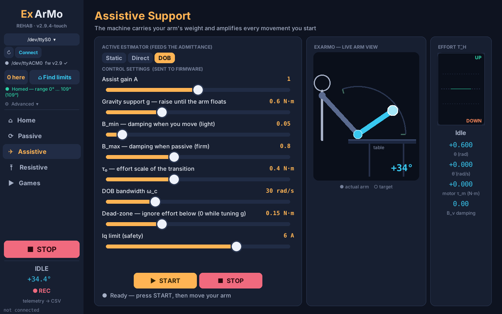
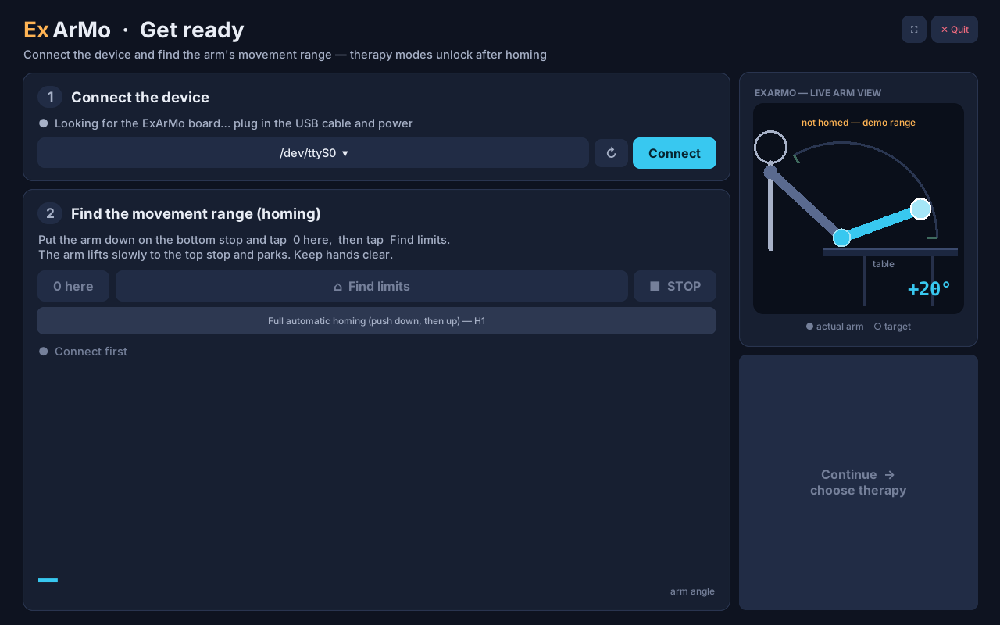
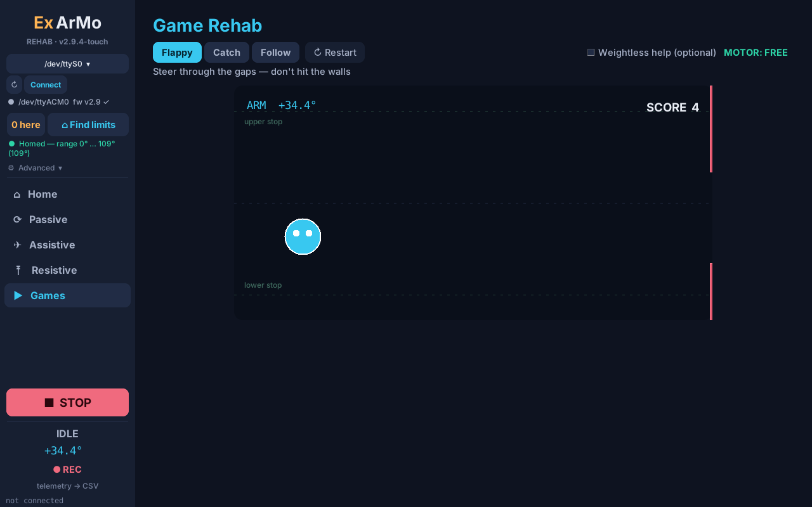

# ExArMo — 1-DOF Elbow Rehabilitation Exoskeleton

**Release v2.9.4** · firmware **v2.9z** · ExArMo Touch app for Raspberry Pi 5 · 20 Oct 2026

ExArMo is a backdrivable, capstan-driven elbow exoskeleton for upper-limb rehabilitation.
It estimates the wearer's own effort (disturbance observer) and uses an effort-adaptive
admittance controller, so the arm feels light when the patient moves and steady when they rest.

<p align="center">
  
  
</p>

---

## Contents
- [What's in v2.9.4](#whats-in-v294)
- [Hardware](#hardware)
- [Repository layout](#repository-layout)
- [Quick start — Raspberry Pi 5 + touchscreen](#quick-start--raspberry-pi-5--touchscreen)
- [Quick start — Windows / macOS](#quick-start--windows--macos)
- [Flashing the firmware](#flashing-the-firmware)
- [Using the device](#using-the-device)
- [Serial protocol](#serial-protocol)
- [Safety](#safety)
- [Updating the Pi from GitHub](#updating-the-pi-from-github)
- [More documentation](#more-documentation)

---

## What's in v2.9.4

| | |
|---|---|
| **ExArMo Touch** (new) | The therapy app redesigned for a 10-inch touchscreen (1280×800 or 1024×600) on a Raspberry Pi 5: fullscreen, rounded touch-sized buttons and sliders, scaled to any screen. |
| **Get ready page** (new) | On start the app connects to the board by itself and asks for homing first. Therapy modes stay locked until the device is connected **and** homed. |
| **Pi setup scripts** (new) | `pi/install_pi.sh` installs everything with one command and adds a desktop icon (autostart optional). |
| **Firmware v2.9z** | v2.9 + manual zero (`Z`), lift-only homing, thermistor on ADC3, driver wake-up (no kick at Start), soft stop (`S`) that lowers the arm to 0°. Unchanged since v2.9.3. |

Full history: [CHANGELOG.md](CHANGELOG.md)

<p align="center">
  
  
</p>

## Hardware

| Part | Details |
|---|---|
| Controller | MKS XDrive Mini (STM32F405, DRV8301 gate driver), USB CDC serial |
| Motor | 5008 BLDC, rewound 40T-Y, KV 123 rpm/V, R 0.47 Ω, L 0.25 mH |
| Transmission | Capstan drive 9.05 : 1, joint torque gain K<sub>t,j</sub> = 0.775 N·m/A (load-cell measured) |
| Sensor | AS5047P magnetic encoder |
| Temperature | 100 k NTC thermistor on PA2 (10 k divider), software model as backup |
| Control | SimpleFOC 2.4.0 · 20 kHz FOC current loop · 1 kHz admittance / DOB loop |
| Host | Raspberry Pi 5 (8 GB) + 10" touchscreen, or any Windows / macOS PC |

## Repository layout

```
├── README.md              ← you are here
├── README_PI.md           ← Raspberry Pi 5 setup, run, update, flash (step by step)
├── CHANGELOG.md           ← every change and the experiment behind it
├── firmware/mks_xdrive_mini_firmware/   PlatformIO project (src/main.cpp = firmware v2.9z)
├── gui/
│   ├── ExArMoTouch_v2.9.4.py   ★ touchscreen therapy app (Pi)      → run_touch.sh / run_touch.bat
│   ├── ExArMoRehab_v2.9.3.py     desktop therapy app                → run_rehab.bat / .command / _pi.sh
│   ├── ExArMoGui_v2.9.py         research control panel (PyQt5)     → run_gui.*
│   ├── ExArMoLab_v2.9.py         automated lab experiments (PyQt5)  → run_lab.*
│   ├── exarmolab.py              motor tester (lab rig)             → run_motortester.*
│   └── requirements.txt
├── pi/                    install_pi.sh · update.sh · flash_firmware.sh · ExArMoTouch.desktop
├── tools/                 log analyzers, homing simulator, make_touch.py (builds the Touch app)
└── docs/                  desktop guide, lab procedures, firmware constants, screenshots
```

## Quick start — Raspberry Pi 5 + touchscreen

Raspberry Pi OS 64-bit (desktop). In a terminal on the Pi:

```bash
git clone git@github.com:<your-user>/<this-repo>.git ~/exarmo
bash ~/exarmo/pi/install_pi.sh        # packages, USB permissions, desktop icon
# log out and back in once, then tap "ExArMo Touch" on the desktop
```

No `.venv` is used on the Pi — all Python packages come from `apt`.
Details, SSH key setup and troubleshooting: **[README_PI.md](README_PI.md)**.

## Quick start — Windows / macOS

Needs Python 3.9+ from python.org (with tkinter).

| App | Windows | macOS |
|---|---|---|
| ExArMo Rehab (desktop therapy app) | `gui\run_rehab.bat` | `gui/run_rehab.command` |
| ExArMo Touch (preview the Pi layout) | `gui\run_touch.bat` | `python3 gui/ExArMoTouch_v2.9.4.py` |
| Control panel / Lab / Motor tester | `run_gui.bat` · `run_lab.bat` · `run_motortester.bat` | `.command` versions |

The first run creates `gui/.venv` and installs `gui/requirements.txt` (≈ 2 min).
Full desktop guide: [docs/README_desktop.md](docs/README_desktop.md).

## Flashing the firmware

1. Open `firmware/mks_xdrive_mini_firmware` in VS Code with the **PlatformIO** extension.
2. Put the board in **DFU mode**: hold BOOT0, tap RESET, release BOOT0.
   (Windows only, once: install the WinUSB driver for "STM32 BOOTLOADER" with Zadig.)
3. **Upload** (PlatformIO sidebar → Upload) or `pio run -t upload`.
4. Press RESET (without BOOT0). The board appears as a serial port (`COMx` / `/dev/ttyACM0`).

From the Pi: `bash pi/flash_firmware.sh` (uses PlatformIO if installed, otherwise `dfu-util`).
Check with the `L` command: the status line must contain `fw=v2.9z`.

## Using the device

1. **Connect** — automatic on the Touch app's *Get ready* page.
2. **Home** — put the arm on the bottom stop → **0 here** → **Find limits**. The arm lifts to the top stop
   and parks. (*Full automatic homing* `H1` pushes down first, then up.)
3. **Continue → choose therapy**:

| Mode | What it does |
|---|---|
| **Passive** | The motor moves the arm between two angles (speed, smoothness, rounds, dwell). |
| **Assistive** | Carries the arm's weight (gravity support *g*) and amplifies the wearer's own movement. |
| **Resistive** | Smooth viscous drag — the faster you move, the harder it resists. |
| **Games** | Flappy, Catch, Follow — played by raising/lowering the arm; motor free or "weightless". |

**STOP** lowers the arm slowly to 0° and then releases the motor; press STOP again to release immediately.
Tune *Gravity support g* once with the arm support fitted (dead-zone 0 while tuning, then back to 0.15 N·m);
it is saved in `gui/rehab_settings.json` and sent to the board on every connect.

## Serial protocol

USB CDC serial (Commander). One command per line.

| Command | Meaning |
|---|---|
| `H` / `H1` | home (lift only after a manual zero) / full automatic homing |
| `Z` | manual zero — current position becomes 0° (IDLE only) |
| `O1` / `O0` | run (admittance) / idle — instant release |
| `S` | soft stop — lower to 0°, then release (`S` again = release now) |
| `E0` `E1` `E2` | effort estimator: static / direct / DOB |
| `A<f>` | assist gain |
| `G<rad>` | passive go-to (joint angle) |
| `D<ms>` | telemetry period (`D2` = 500 Hz request) |
| `L` | status dump (firmware version, limits, zero, thermal source) |
| `P<letter><value>` | parameters, e.g. `Pg0.6` gravity, `Pz0.15` dead-zone, `Pi6` Iq limit, `Ph1.2` homing current |
| `T` / `X<°C>` | thermistor dump / calibrate beta at a known temperature |

Telemetry line:
`D,t_ms,state,theta,theta_ref,vel,iq_meas,tau_m,tau_s,tau_d,tau_dob,Bv,iq_cmd,T_est` (rad, N·m, A, °C).
Events start with `EV,` (e.g. `EV,HOMED,<min>,<max>`, `EV,ZERO,…`, `EV,SOFTSTOP,…`, `EV,PARKED`, `EV,TEMPWARN`).
States: 0 IDLE · 1/2 HOMING · 3 PARKING · 4 RUN · 5 FAULT · 6 PASSIVE · 7 LAB.

## Safety

- **Emergency stop = cut motor power.** The capstan drive is backdrivable — the wearer can always overpower it.
- Software limits: Iq clamp 6 A · virtual walls at the homed limits · range fault → motor off · park timeout.
- Temperature: warning + current derate from 40 °C, coast-stop at 55 °C (thermistor); software model when no thermistor.
- Therapy modes cannot start before homing (Touch app). Always home after power-up or after the rope is adjusted.
- This is a research prototype, not a certified medical device. Use under supervision.

## Updating the Pi from GitHub

On the PC: commit and push (VS Code → Source Control → Commit → Sync).
On the Pi:

```bash
bash ~/exarmo/pi/update.sh      # = git pull
```

`.gitignore` keeps `.venv`, PlatformIO builds (`.pio`), logs and the local `rehab_settings.json` out of the repo.
`.gitattributes` keeps Linux line endings on `.sh` files so they run on the Pi even when committed from Windows.

If you change the desktop Rehab app, rebuild the Touch app with:
```bash
python3 tools/make_touch.py gui/ExArMoRehab_v2.9.3.py gui/ExArMoTouch_v2.9.4.py
```

## More documentation

| File | Content |
|---|---|
| [README_PI.md](README_PI.md) | Raspberry Pi install, run, update, flash, troubleshooting |
| [docs/README_desktop.md](docs/README_desktop.md) | Windows / macOS guide, all apps, analysis tools |
| [CHANGELOG.md](CHANGELOG.md) | Firmware and GUI history with the experiments behind each value |
| [docs/lab_procedures.md](docs/lab_procedures.md) | ExArMo Lab: gravity, plant ID, transparency, thermal checks |
| [docs/firmware_v2.9_constants.md](docs/firmware_v2.9_constants.md) | Motor and drive constants with sources |
| [docs/E08_rerun_procedure.md](docs/E08_rerun_procedure.md) | Estimator comparison session procedure |
